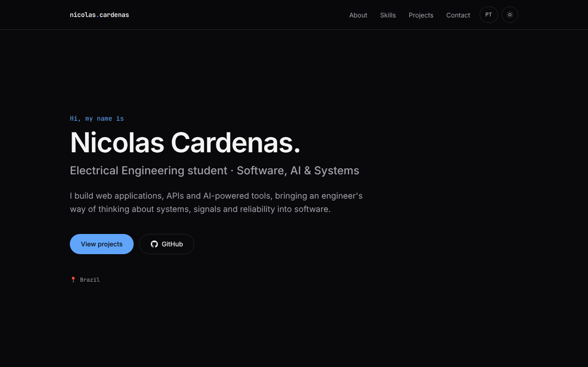
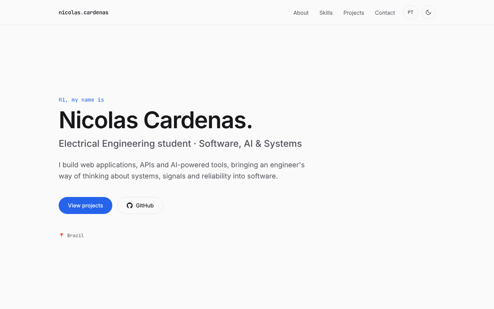
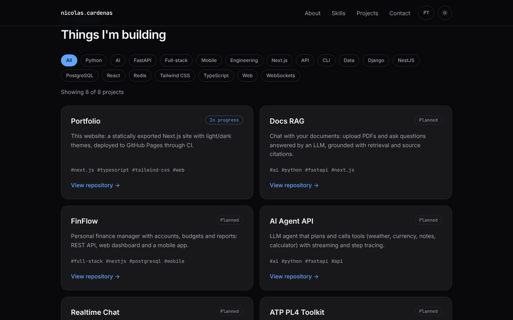
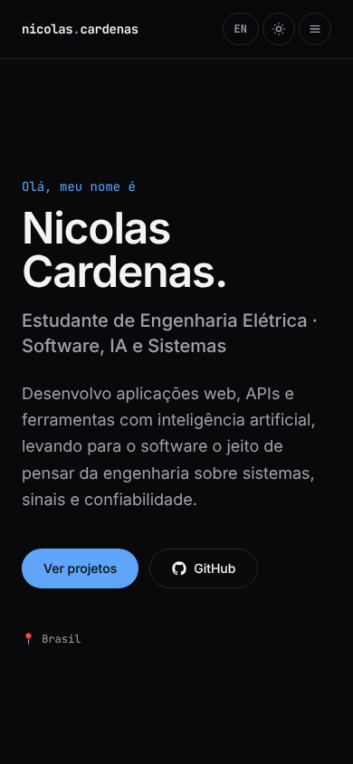
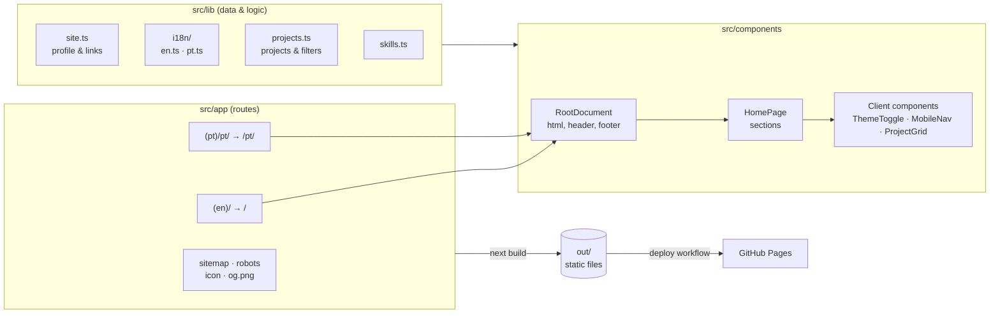

# nicolascardenass.github.io

[](https://github.com/NicolasCardenass/nicolascardenass.github.io/actions/workflows/ci.yml)
[](https://github.com/NicolasCardenass/nicolascardenass.github.io/actions/workflows/deploy.yml)
[](./LICENSE)

> 🇧🇷 Resumo em português no [final deste arquivo](#resumo-em-português).

Personal portfolio of **Nicolas Cardenas**, built with Next.js, TypeScript and Tailwind CSS and
published as a static site on GitHub Pages, in English and Brazilian Portuguese.

**Live site:** <https://nicolascardenass.github.io> · [Versão em português](https://nicolascardenass.github.io/pt/)



## Features

- **Fully static** — exported to plain HTML/CSS/JS at build time and served by GitHub Pages, with no
  server to maintain.
- **Light and dark themes** — follows the system preference by default, remembers the visitor's
  choice and applies it before the first paint (no flash of the wrong theme).
- **Two languages** — English at `/` and Portuguese at `/pt/`, each a separate static page with the
  correct `lang`, canonical URL and `hreflang` alternates.
- **Filterable projects** — project cards with status badges and a tag filter.
- **Accessible** — semantic HTML, skip link, keyboard-friendly mobile menu, visible focus styles,
  `prefers-reduced-motion` support; audited with axe-core with no violations.
- **SEO-ready** — metadata, Open Graph/Twitter cards with a generated preview image, sitemap and
  robots.txt.
- **Tested and automated** — unit and component tests, plus CI on every push and automatic
  deployment from `main`.

<table>
  <tr>
    <td></td>
    <td></td>
  </tr>
  <tr>
    <td align="center">Light theme</td>
    <td align="center">Projects with tag filter</td>
  </tr>
</table>

<p align="center">
  
</p>

## Tech stack

| Area      | Tools                                                               |
| --------- | ------------------------------------------------------------------- |
| Framework | [Next.js](https://nextjs.org/) 16 (App Router, `output: "export"`)  |
| Language  | TypeScript (strict mode)                                            |
| Styling   | Tailwind CSS v4, CSS custom properties as design tokens, Fontsource |
| Testing   | Vitest, React Testing Library, user-event, jsdom                    |
| Quality   | ESLint (Next.js config), Prettier, `tsc --noEmit`                   |
| CI/CD     | GitHub Actions, GitHub Pages                                        |

## Architecture



Each language is its own route group with a root layout, and both render the same `RootDocument`
and `HomePage` components with a different dictionary. Almost everything is rendered at build time;
only the theme toggle, the mobile menu and the project filter ship JavaScript to the browser.

### Project structure

```text
src/
├── app/
│   ├── (en)/            # English root layout and page → /
│   ├── (pt)/pt/         # Portuguese root layout and page → /pt/
│   ├── og.png/          # Social preview image rendered at build time
│   ├── icon.svg         # Favicon
│   ├── robots.ts
│   └── sitemap.ts
├── components/          # Layout, sections and interactive components (+ tests)
├── lib/
│   ├── i18n/            # Locales, typed dictionaries and format helper
│   ├── metadata.ts      # Per-locale SEO metadata
│   ├── projects.ts      # Project data and pure filter helpers
│   ├── skills.ts
│   ├── site.ts          # Name, links and URLs
│   └── theme.ts         # Theme storage key and pre-paint script
├── styles/globals.css   # Tailwind, design tokens, global styles
└── test/setup.ts
```

## Technical decisions

- **Static export over a server.** The site has no per-request data, so building it once and serving
  files from GitHub Pages is free, fast and has nothing to operate. The trade-off is no server
  features (API routes, image optimization), which this site does not need.
- **Theme applied before hydration.** A tiny inline script in `<head>` reads `localStorage` (or the
  system preference) and sets `data-theme` on `<html>` before the page is painted. Colors are CSS
  variables keyed on that attribute, so components never hard-code a color.
- **One static page per language.** Instead of detecting the language in the browser, each locale is
  generated at its own URL with its own root layout. This avoids a flash of the wrong language and
  lets search engines index both versions correctly.
- **Serializable dictionaries.** Text templates use `{placeholder}` strings instead of functions, so
  dictionaries can be passed from Server Components to Client Components.
- **Pure logic, tested separately.** Filtering and tag collection are pure functions with their own
  unit tests; components are tested through accessible roles and names, the way users interact with
  them.
- **Real `.png` for the social image.** The Open Graph image is served from an `og.png` route so
  static hosts send the correct content type.

## Getting started

Requirements: Node.js 22+.

```bash
npm install
npm run dev        # http://localhost:3000
```

## Scripts

| Script                  | Description                              |
| ----------------------- | ---------------------------------------- |
| `npm run dev`           | Start the development server             |
| `npm run build`         | Build the static site into `out/`        |
| `npm run start`         | Serve the exported site locally          |
| `npm run lint`          | Run ESLint                               |
| `npm run typecheck`     | Type-check the project with `tsc`        |
| `npm test`              | Run unit tests with Vitest               |
| `npm run test:coverage` | Run tests with a coverage report         |
| `npm run format`        | Format all files with Prettier           |
| `npm run format:check`  | Check formatting without writing changes |

## Testing

```bash
npm test                 # run once
npm run test:watch       # watch mode
npm run test:coverage    # with coverage report in coverage/
```

Tests cover the project helpers and data integrity, dictionary parity between languages, the project
filter (including the Portuguese version), the theme toggle and the mobile menu.

## Deployment

Every push to `main` triggers two workflows:

- [CI](./.github/workflows/ci.yml): lint, formatting check, type-check, tests with coverage and a
  production build. Also runs on pull requests.
- [Deploy](./.github/workflows/deploy.yml): runs the tests, builds the static site into `out/` and
  publishes it to GitHub Pages.

In the repository settings, **Pages → Source** must be set to **GitHub Actions**.

## Roadmap

Development history is tracked in [ROADMAP.md](./ROADMAP.md).

## License

[MIT](./LICENSE) © Nicolas Cardenas

---

## Resumo em português

Portfólio pessoal de **Nicolas Cardenas**, feito com Next.js, TypeScript e Tailwind CSS e publicado
como site estático no GitHub Pages, em inglês (`/`) e português (`/pt/`).

**Principais recursos:** tema claro/escuro sem "piscar", duas versões de idioma geradas no build,
filtro de projetos por tag, acessibilidade auditada com axe-core, SEO com imagem de prévia para
redes sociais, testes automatizados com Vitest e Testing Library, CI e deploy automático com GitHub
Actions.

**Para rodar localmente:** com Node.js 22+, execute `npm install` e `npm run dev` e acesse
<http://localhost:3000>. Os testes rodam com `npm test`.
